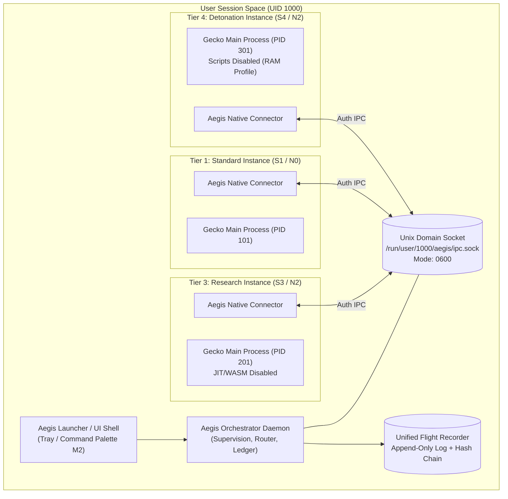

# SPIKE-006: Launcher and Multi-Instance Orchestrator Design

**Document Version:** 1.0.0  
**Date:** 2026-10-23  
**Status:** DESIGN ONLY (No implementation until approved)  
**Addresses:** Process-Tiered Architecture (A-001, SPIKE-005)  
**Target Platform:** Linux desktop (X11 / Wayland)  

---

## 1. Executive Summary & Objectives

Under the Process-Tiered Architecture ([A-001](file:///home/god/Ageis/docs/spec-amendments/A-001.md)), Aegis Browser runs separate Gecko instances for distinct attack-surface and network tiers (Standard S1/N0, Guarded S2/N1, Research S3/N2, Detonation S4/N2). 

SPIKE-006 specifies the technical architecture for the **Aegis Orchestrator**—a lightweight, privileged local daemon that supervises instance processes, brokers inter-instance URL hand-offs, manages authenticated local IPC, and maintains an immutable, shared Flight Recorder hash chain.

---

## 2. Component Architecture



---

## 3. Process Spawning & Lifecycle Management

### 3.1 Supervised Process Execution
1. **Spawn Mechanics:** The orchestrator spawns instance processes using standard `fork`/`exec` with clean process group isolation (`setpgid`).
2. **Environment Scrubbing:**
   - Uncontrolled environment variables are stripped.
   - Strictly controlled parameters are injected:
     - `AEGIS_SURFACE_TIER=<S1|S2|S3|S4>`
     - `AEGIS_IPC_SOCKET=/run/user/<UID>/aegis/ipc.sock`
     - `AEGIS_AUTH_TOKEN=<random-256bit-hex>`
3. **Dedicated Profile Paths:**
   - Standard: `~/.local/share/aegis/profiles/standard`
   - Strict: `~/.local/share/aegis/profiles/strict`
   - Research/Tor: `~/.local/share/aegis/profiles/research`
   - Detonation: `/dev/shm/aegis/detonation_<uuid>` (RAM-backed, deleted on process exit)
4. **Lifecycle Control & Fail-Closed Termination:**
   - When an instance terminates unexpectedly or crashes, the orchestrator detects the exit code via `SIGCHLD`.
   - If a crash occurs in a Tor tier (N2/N3), the orchestrator immediately closes dependent routes to prevent silent fallbacks.
   - Clean shutdown dispatches `SIGTERM`, waits a 4-second grace period for sqlite storage commits, then issues `SIGKILL`.

---

## 4. Local Inter-Process Communication (IPC)

### 4.1 Transport & Permissions
* **Mechanism:** Unix Domain Sockets (`AF_UNIX`, `SOCK_STREAM`).
* **Path:** `/run/user/$UID/aegis/ipc.sock` (utilizes Linux `tmpfs` XDG_RUNTIME_DIR).
* **Permissions:** Directory mode `0700`, socket mode `0600`. Only the operating system user running Aegis can open or connect to the socket.

### 4.2 Authentication & Verification Handshake
To prevent unauthorized processes running under the same UID (e.g. arbitrary user scripts) from spoofing orchestrator messages:
1. **Kernel Credential Verification (`SO_PEERCRED`):** The orchestrator queries `SO_PEERCRED` upon connection to verify that the peer PID, UID, and GID strictly match the expected user.
2. **Cryptographic Token Handshake:**
   - Upon spawning an instance, the orchestrator generates an ephemeral 32-byte secret $K_{\text{inst}}$.
   - Immediately upon connecting, the instance must transmit a JSON handshake:
     ```json
     { "action": "AUTH", "instance_id": "tier-s3", "token": "7f8b9..." }
     ```
   - If the token does not match $K_{\text{inst}}$, the orchestrator immediately closes the connection and records a security tripwire.
3. **Wire Protocol Framing:** Length-prefixed JSON (4-byte big-endian payload length followed by UTF-8 JSON payload).

---

## 5. URL Hand-Off Protocol (Escalation & Cross-Tier Navigation)

When Link Guard in a less restrictive tier (e.g. S1) determines that a link requires S3 (Strict) or S4 (Detonation) isolation:

```mermaid
sequenceDiagram
    participant User
    participant Standard_Inst as Standard Instance (S1)
    participant Orchestrator as Aegis Orchestrator
    participant Detonation_Inst as Detonation Instance (S4)

    User->>Standard_Inst: Click Link (High-Risk Phishing/Lure Detected)
    Standard_Inst->>Standard_Inst: Link Guard pauses navigation; renders Interstitial Warning
    User->>Standard_Inst: User selects "Inspect in Detonation Cell"
    Standard_Inst->>Orchestrator: IPC: HANDOFF_URL { url, target_tier: "S4", reason: "credential_lure" }
    Orchestrator->>Orchestrator: Validate URL scheme (block file://, about:); Record in Ledger
    alt Detonation Instance Running?
        Orchestrator->>Detonation_Inst: IPC: OPEN_TAB { url, mode: "detonation" }
    else Not Running
        Orchestrator->>Detonation_Inst: Spawn Process (AEGIS_SURFACE_TIER=S4) + Pass URL
    end
    Detonation_Inst->>User: Renders static page (JS disabled, JIT off) in Detonation window
    Standard_Inst->>User: Closes original tab / displays hand-off receipt
```

### 5.1 URL Sanitization Rules
* Only `http://`, `https://`, and `onion://` schemes are eligible for hand-off.
* `file://`, `about:`, `chrome://`, `resource://`, and `javascript:` URLs are **strictly rejected**.
* Tracking parameters (`utm_*`, `fbclid`) are stripped by Link Cleaner before hand-off.

---

## 6. Shared Flight Recorder Log Integrity

### 6.1 Cryptographic Hash Chaining
All instances stream telemetry-free operational audit events (navigation, TLS parameters, Link Guard decisions, tripwires) to the orchestrator over IPC.

The orchestrator appends events to an immutable log file protected by a cryptographic hash chain:
$$H_0 = \text{SHA-256}(\text{"AEGIS_GENESIS_"} \parallel \text{session\_uuid})$$
$$H_i = \text{SHA-256}(H_{i-1} \parallel \text{timestamp} \parallel \text{instance\_id} \parallel \text{payload})$$

### 6.2 Tamper Resistance Properties
1. **Process Privilege Boundary:** Individual browser renderers and extensions have write-only access to their IPC connection; they cannot read or overwrite previous entries on disk.
2. **Forward Integrity:** If a renderer is exploited in an S1 tab, the attacker cannot alter prior log entries in $H_0 \dots H_{i-1}$ without causing a hash mismatch detected upon verification.
3. **Crash Resilience:** Each block is flushed to disk with atomic write commits.

---

## 7. Threat Model & Security Analysis

| Threat / Attack Vector | Attacker Capability | Mitigation in Orchestrator Design |
| :--- | :--- | :--- |
| **Exploited Renderer Sandbox Escape** | Compromised web renderer in Tier S1 attempts to lower security settings for other tabs. | S3/S4 run in separate OS processes. Autoconfig locks cannot be modified via IPC. Hand-off requests only allow escalating *upward* to stricter tiers. |
| **Malicious Local Script Injection** | Untrusted process running under same user attempts to send fake hand-offs or read logs. | Socket mode `0600` + `SO_PEERCRED` UID check + ephemeral 256-bit token handshake. Unauthorized connections are dropped immediately. |
| **Log Truncation / Erasure Attack** | Exploit attempts to wipe evidence of an attack from the Flight Recorder. | Append-only hash chain. Truncating or deleting records breaks cryptographic continuity. |
| **URL Injection / Scheme Abuse** | Malicious page lures Link Guard to trigger hand-off of a local `file:///etc/passwd` link. | Strict scheme validation: only `http(s)` permitted. Internal and file schemes blocked. |
| **Denial of Service via Instance Flooding** | Attacker repeatedly triggers hand-offs to spawn hundreds of instances. | Orchestrator enforces max instance limits (at most 4 named tiers). Reuses existing running tier instances. |

---

## 8. Recommendation & Status

SPIKE-006 is complete as an architectural specification. **No code implementation will be started until formal owner sign-off.**
