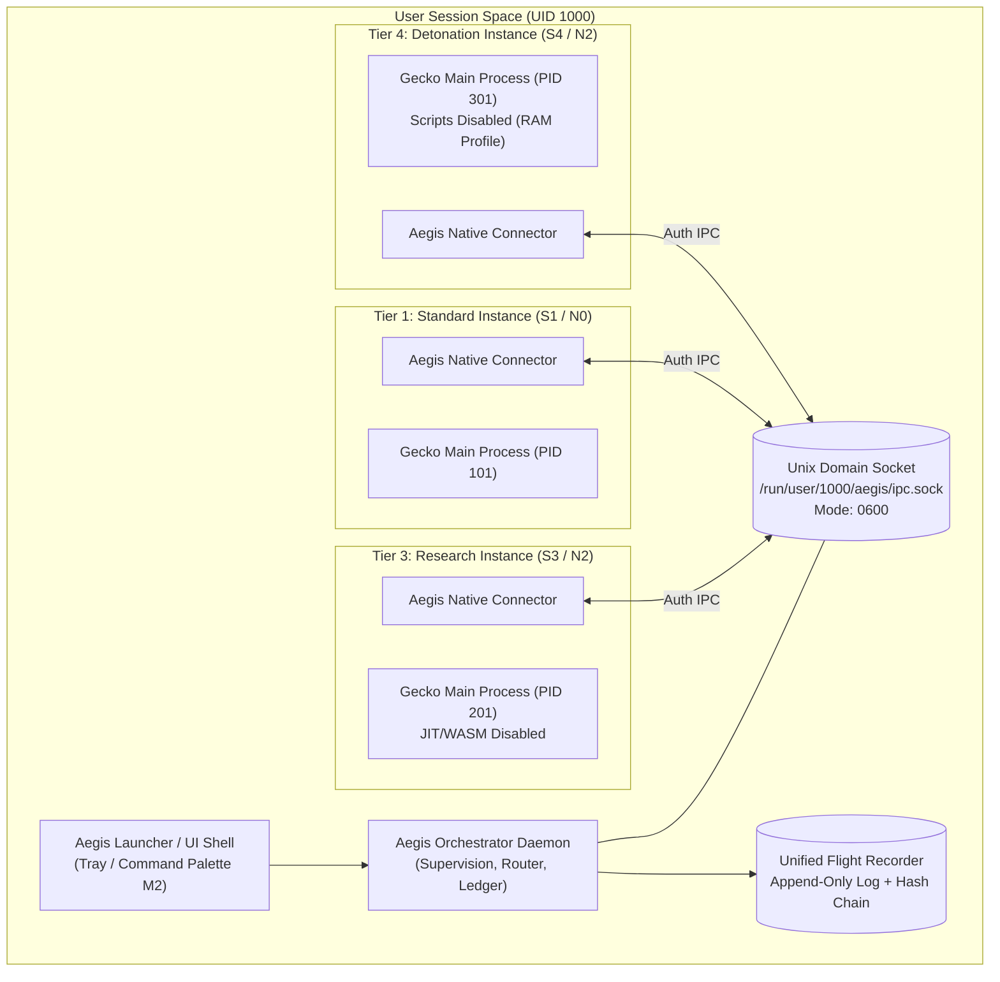

# SPIKE-006: Launcher and Multi-Instance Orchestrator Design

**Document Version:** 1.0.0  
**Date:** 2026-10-23  
**Status:** DESIGN ONLY (No implementation until approved)  
**Addresses:** Process-Tiered Architecture (A-001, SPIKE-005)  
**Target Platform:** Linux desktop (X11 / Wayland)  

---

## 1. Executive Summary & Objectives

Under the Process-Tiered Architecture ([A-001](../spec-amendments/A-001.md)), Aegis Browser runs separate Gecko instances for distinct attack-surface and network tiers (Standard S1/N0, Guarded S2/N1, Research S3/N2, Detonation S4/N2). 

SPIKE-006 specifies the technical architecture for the **Aegis Orchestrator**—a lightweight, privileged local daemon that supervises instance processes, brokers inter-instance URL hand-offs, manages authenticated local IPC, and maintains an immutable, shared Flight Recorder hash chain.

---

## 2. Component Architecture



---

## 3. Process Spawning & Lifecycle Management

### 3.1 Supervised Process Execution
1. **Spawn Mechanics:** The orchestrator spawns instance processes using standard `fork`/`exec` with clean process group isolation (`setpgid`).
2. **Environment Scrubbing:**
   - Uncontrolled environment variables are stripped.
   - Strictly controlled parameters are injected:
     - `AEGIS_SURFACE_TIER=<S1|S2|S3|S4>`
3. **IPC Connection Passing:**
   - Communication is passed directly via an inherited file descriptor from a connected `socketpair` (`AF_UNIX`, `SOCK_STREAM`), avoiding filesystem sockets and environment-variable tokens.
4. **Dedicated Profile Paths:**
   - Standard: `~/.local/share/aegis/profiles/standard`
   - Strict: `~/.local/share/aegis/profiles/strict`
   - Research/Tor: `~/.local/share/aegis/profiles/research`
   - Detonation: `/dev/shm/aegis/detonation_<uuid>` (RAM-backed, deleted on process exit)
5. **Lifecycle Control & Fail-Closed Termination:**
   - When an instance terminates unexpectedly or crashes, the orchestrator detects the exit code via `SIGCHLD`.
   - If a crash occurs in a Tor tier (N2/N3), the orchestrator immediately closes dependent routes to prevent silent fallbacks.
   - Clean shutdown dispatches `SIGTERM`, waits a 4-second grace period for sqlite storage commits, then issues `SIGKILL`.

---

## 4. Local Inter-Process Communication (IPC)

### 4.1 Transport via Inherited Socketpair
* **Mechanism:** Connected Unix Domain Socketpair (`socketpair(AF_UNIX, SOCK_STREAM, 0)`).
* **Inherited File Descriptor:** Before `exec`, the orchestrator creates the socketpair, retains the parent endpoint, marks the child endpoint non-close-on-exec, and duplicates it to a fixed descriptor (e.g. FD 3, passed via `--aegis-ipc-fd=3`). The orchestrator closes the child descriptor in its own process.
* **Security Advantages:**
  - **Zero Filesystem Exposure:** No socket node is created in `/run/user/` or `/tmp/`, completely eliminating filesystem race conditions, unauthorized socket connects from same-UID processes, and symlink attacks.
  - **No Shared Token in Environment:** No authentication secret or token needs to be stored in environment variables (which could otherwise be visible in `/proc/<pid>/environ` to other processes running as the same UID).
  - **Kernel-Guaranteed Peer Identity:** The kernel guarantees that the other end of the socketpair is uniquely and exclusively connected to the spawned child process.

### 4.2 Protocol Framing
* **Wire Protocol Framing:** Length-prefixed JSON (4-byte big-endian payload length followed by UTF-8 JSON payload).
* **Heartbeat & Liveness:** Bidirectional ping/pong every 15 seconds. If an instance fails to respond within 30 seconds, it is flagged as unresponsive and restarted fail-closed.

---

## 5. URL Hand-Off Protocol (Escalation & Cross-Tier Navigation)

When Link Guard in a less restrictive tier (e.g. S1) determines that a link requires S3 (Strict) or S4 (Detonation) isolation:

```mermaid
sequenceDiagram
    participant User
    participant Standard_Inst as Standard Instance (S1)
    participant Orchestrator as Aegis Orchestrator
    participant Detonation_Inst as Detonation Instance (S4)

    User->>Standard_Inst: Click Link (High-Risk Phishing/Lure Detected)
    Standard_Inst->>Standard_Inst: Link Guard pauses navigation; renders Interstitial Warning
    User->>Standard_Inst: User selects "Inspect in Detonation Cell"
    Standard_Inst->>Orchestrator: IPC: HANDOFF_URL { url, target_tier: "S4", reason: "credential_lure" }
    Orchestrator->>Orchestrator: Validate URL scheme; Record domain in Ledger
    alt Detonation Instance Running?
        Orchestrator->>Detonation_Inst: IPC: OPEN_TAB { url, mode: "detonation" }
    else Not Running
        Orchestrator->>Detonation_Inst: Spawn Process (AEGIS_SURFACE_TIER=S4) + Pass FD & URL
    end
    Detonation_Inst->>User: Renders static page (JS disabled, JIT off) in Detonation window
    Standard_Inst->>User: Closes original tab / displays hand-off receipt
```

### 5.1 URL Sanitization & Scheme Rules
* Only standard `http://` and `https://` schemes are eligible for hand-off.
* `.onion` addresses use standard `http://` or `https://` schemes and are routed exclusively via the Tor SOCKS proxy in the Research/Tor tier (N2/N3). The pseudo-scheme `onion://` is not permitted.
* `file://`, `about:`, `chrome://`, `resource://`, and `javascript:` URLs are **strictly rejected**.
* Tracking parameters (`utm_*`, `fbclid`, etc.) are stripped by Link Cleaner before hand-off.

### 5.2 Privacy-Preserving Hand-Off Logging
* **Domain-Only by Default:** The Flight Recorder records only the registrable domain (`registrable_domain`), target tier, escalation rule, and timestamp.
* **Full URL Opt-In:** Full URLs (including query parameters and path fragments) are **never logged by default** to protect user privacy from credential/token leakage. Recording full URLs is an explicit, opt-in developer/forensic setting.

---

## 6. Shared Flight Recorder Log Integrity

### 6.1 Tamper-Evident Hash Chaining
All instances stream telemetry-free operational audit events (navigation, TLS parameters, Link Guard decisions, tripwires) to the orchestrator over IPC.

The orchestrator appends events to a **tamper-evident log** protected by a cryptographic hash chain:
$$H_0 = \text{SHA-256}(\text{"AEGIS_GENESIS_"} \parallel \text{session\_uuid})$$
$$H_i = \text{SHA-256}(H_{i-1} \parallel \text{timestamp} \parallel \text{instance\_id} \parallel \text{payload})$$

### 6.2 Keyed HMAC & Signed Checkpoints
To defend against local processes truncating or rewriting the append-only log file:
1. **Keyed In-Memory HMAC Option:**
   $$H_i = \text{HMAC-SHA-256}(K_{\text{log}}, H_{i-1} \parallel \text{timestamp} \parallel \text{instance\_id} \parallel \text{payload})$$
   where $K_{\text{log}}$ is an ephemeral 256-bit secret generated in memory by the orchestrator at startup. Even if a local process gains access to the log file on disk, it cannot forge valid hashes without $K_{\text{log}}$.
2. **Periodic Signed Checkpoints:**
   Every 100 entries (or 10 minutes), the orchestrator writes a signed checkpoint digest (e.g. Ed25519 signature over $H_i$) to a separate, append-only checkpoint ledger.

### 6.3 Tamper-Evident Properties & Honest Limits
1. **Process Privilege Boundary:** Individual browser renderers and extensions have write-only access to their IPC connection; they cannot read or overwrite previous entries on disk.
2. **Forward Integrity:** If a renderer is exploited in an S1 tab, the attacker cannot alter prior log entries in $H_0 \dots H_{i-1}$ without causing a hash mismatch detected upon verification.
3. **Honest Boundary:** The log is **tamper-evident**, not immutable against root or direct disk compromise. Malware with kernel or full OS privileges can rewrite disk blocks. The hash chain guarantees detection of modification or truncation by unprivileged processes.

---

## 7. Threat Model & Security Analysis

| Threat / Attack Vector | Attacker Capability | Mitigation in Orchestrator Design |
| :--- | :--- | :--- |
| **Exploited Renderer Sandbox Escape** | Compromised web renderer in Tier S1 attempts to lower security settings for other tabs. | S3/S4 run in separate OS processes. Autoconfig locks cannot be modified via IPC. Hand-off requests only allow escalating *upward* to stricter tiers. |
| **Malicious Local Script Injection** | Untrusted process running under same user attempts to send fake hand-offs or read logs. | Direct `socketpair` inheritance: no listening socket or filesystem path exists for other processes to connect to. |
| **Log Truncation / Erasure Attack** | Exploit attempts to wipe evidence of an attack from the Flight Recorder. | Append-only hash chain with in-memory HMAC and signed checkpoints detects truncation or record rewriting. |
| **URL Injection / Scheme Abuse** | Malicious page lures Link Guard to trigger hand-off of a local `file:///etc/passwd` link. | Strict scheme validation: only `http(s)` permitted. Internal and file schemes blocked. |
| **URL Parameter Data Leakage** | Exploit or log observer inspects Flight Recorder to harvest sensitive tokens from URLs. | Privacy-preserving logging: only registrable domain logged by default; full URL is strict opt-in. |
| **Denial of Service via Instance Flooding** | Attacker repeatedly triggers hand-offs to spawn hundreds of instances. | Orchestrator enforces max instance limits (at most 4 named tiers). Reuses existing running tier instances. |

---

## 8. Recommendation & Status

SPIKE-006 is complete as an architectural specification. **No code implementation will be started until formal owner sign-off.**
