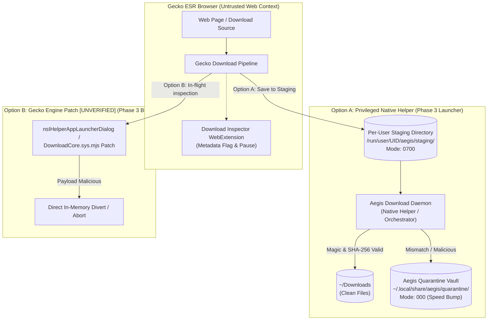

# SPIKE-007: Byte-Level Download Inspection and Quarantine Architecture

**Document Version:** 1.1.0  
**Date:** 2026-10-24  
**Status:** DESIGN ONLY (Exploratory spike; no implementation until approved)  
**Addresses:** Master Spec Part 5.8 (M8 Download Inspector), Part 5.2 row 8 (Quarantine integration)  
**Target Engine:** Mozilla Firefox ESR 153.5.1esr on Linux x86_64  

---

## 1. Problem Statement & WebExtension Sandbox Limits

In Phase 2d, the **Download Inspector** (`modules/download-inspector`) was implemented as a WebExtension operating under least privilege:
* **Permissions:** `downloads`, `storage` only.
* **Prohibited:** `<all_urls>` (host permission), `nativeMessaging`, `tabs`, filesystem access.

### 1.1 The WebExtension Limitation
Under Gecko's WebExtension architecture, `browser.downloads.onCreated` receives a `DownloadItem` object containing metadata only:
* `downloadItem.id`, `downloadItem.url`, `downloadItem.filename`, `downloadItem.mime`, `downloadItem.fileSize`.

The WebExtension runtime **cannot read raw file bytes** for the following reasons:
1. **No Filesystem Access:** WebExtensions execute in a restricted sandbox without POSIX file I/O capabilities. They cannot open the destination file path returned by Gecko.
2. **No Cross-Origin Re-fetch:** Without `<all_urls>`, background scripts cannot `fetch(downloadItem.url)`.
3. **Re-fetching is Unsound:** Even if `<all_urls>` were granted, re-fetching download URLs over HTTP/HTTPS is flawed:
   - Downloads often use single-use tokens, POST requests, or authenticated sessions that fail or mutate state on re-request.
   - Re-downloading wastes network bandwidth and does not guarantee that the re-fetched bytes match what Gecko wrote to disk.
4. **Mislabeling "Quarantine":** The WebExtension can only log/flag metadata and call `browser.downloads.pause(downloadItem.id)`. It cannot isolate the file in a secure filesystem vault. Calling this "quarantine" was inaccurate; it is an **audit log and download pause** mechanism. The storage key is strictly `download_flag_log`.

### 1.2 Constraint
**Do NOT widen WebExtension permissions.** Adding `<all_urls>` or arbitrary native messaging to the extension manifest violates least-privilege principles and introduces a massive attack surface. Genuine byte-level inspection and file isolation must be handled outside the untrusted WebExtension sandbox.

---

## 2. Architectural Alternatives for Byte/Hash Inspection

---

## 3. Detailed Option Evaluation

### Option A: Privileged Native Helper Daemon
In Option A, the browser is configured via preferences (`browser.download.dir`, `browser.download.folderList: 2`) to write all incoming downloads into a private, monitored staging directory located strictly in the **per-user runtime directory** (`$XDG_RUNTIME_DIR/aegis/staging/` or `/run/user/<UID>/aegis/staging/` with permissions `0700`).

> [!CAUTION]
> **Never use `/tmp`:** Global shared `/tmp` is insecure on multi-user Linux hosts due to symlink attacks, race conditions, and world-readable default masks. Staging must reside strictly in the user's isolated `XDG_RUNTIME_DIR`.

> [!IMPORTANT]
> **Ownership invariant (2026-10-24 correction):** The staging directory MUST be
> owned by the invoking user (the same UID that runs the Aegis orchestrator and
> the browser), with mode `0700` — **never root**. The download daemon is a
> per-user process; it must never require, request, or run with root
> privileges. The orchestrator MUST verify at creation time (fail closed) that:
> `$XDG_RUNTIME_DIR/aegis` and `$XDG_RUNTIME_DIR/aegis/staging` are owned by
> the current UID (EUID == st_uid) and have mode `0700`; any mismatch (root
> ownership, group/other bits set, symlinked path) aborts the staging setup and
> the download flow fails closed. Note: `$XDG_RUNTIME_DIR` itself is created by
> the login manager (systemd) with user ownership — Aegis must never relax it.

1. **Disable Open-After-Download (Mandatory Invariant):**
   - The browser and desktop must NOT automatically open or execute downloaded files prior to verification.
   - Preferences locked in `aegis.cfg`:
     - `browser.download.openImmediately: false`
     - `browser.helperApps.neverAsk.openFile: ""`
     - Desktop MIME handler associations (`xdg-open`) suppressed in staging.
2. **Flow:**
   - Gecko streams the download into `/run/user/<UID>/aegis/staging/`.
   - When download completes (`downloads.onChanged` [state: 'complete'] or inotify `IN_CLOSE_WRITE`), the Aegis Native Helper reads the first 4KB of the file.
   - **Signature Verification:** Validates magic bytes (MZ, ELF, Mach-O, PDF, ZIP, PNG, etc.) against the claimed extension.
   - **Integrity Hash:** Calculates full file SHA-256 hash using native cryptographic libraries.
   - **Triage:**
     - **Clean:** Atomic `rename()` / `move` into `~/Downloads/`.
     - **Flagged / Malicious:** Atomic move into `~/.local/share/aegis/quarantine/`, permissions stripped (`chmod 0000`), logged to Flight Recorder.
3. **TOCTOU (Time-of-Check to Time-of-Use) Analysis:**
   - *Risk:* A malicious local process or user desktop indexer attempts to read or execute the file while Gecko is writing it or between the time the inspection check completes and the file is moved.
   - *Mitigations:*
     - Staging directory is created with mode `0700` owned exclusively by `<UID>`.
     - The helper opens the file with exclusive locks (`O_RDONLY | O_NOFOLLOW | O_CLOEXEC`), inspects file descriptors (`fstat`), and verifies inode identity before and after hashing.
     - Moving to `~/Downloads/` or `quarantine/` uses atomic filesystem `renameat2(..., RENAME_NOREPLACE)`.
4. **Honest Appraisal of `chmod 0000`:**
   - Stripping permissions (`chmod 0000`) is **only a speed bump**.
   - It prevents accidental desktop double-clicking or inadvertent script execution.
   - It is **NOT a true security boundary** against adversarial code already executing under the same user UID, because any process owned by `<UID>` can issue a `chmod(..., 0644)` syscall to restore read/execute permissions. Genuine process isolation requires DAC/MAC sandboxing (Bubblewrap / SELinux / AppArmor).
5. **Limitations:**
   - Requires the local launcher/orchestrator daemon to be running.

### Option B: Gecko Engine Patch in Download Pipeline [UNVERIFIED]

> [!WARNING]
> **Option B is UNVERIFIED:** This approach represents a hypothetical design hypothesis. It has not been implemented or verified against the Mozilla ESR 153.5.1 source tree. Full evaluation requires a dedicated C++ engine spike and custom compilation pipeline in Phase 3 ([BUILD.md](../../BUILD.md)).

In Option B, inspection would be embedded directly into Gecko's download pipeline source code (`toolkit/components/downloads/DownloadCore.sys.mjs` and `uriloader/exthandler/nsIHelperAppLauncherDialog.cpp`):

1. **Hypothetical Flow:**
   - Gecko's download channel streams bytes through an in-memory `nsIStreamListener` tee.
   - As the initial chunk arrives (first 4KB), Gecko checks the magic signature against the destination filename.
   - If a high-risk mismatch is detected (e.g. `.pdf` containing `MZ` binary header):
     - The channel is immediately canceled (`NS_BINDING_ABORTED`).
     - No file is created on the filesystem.
     - A native Gecko alert / security prompt is displayed to the user.
2. **Security & Privilege Boundaries:**
   - Strongest possible security guarantee: malicious payloads never touch disk storage.
   - Fully integrated into browser UI without external helper processes.
3. **Limitations & Open Questions:**
   - **Unverified:** Requires deep modification of Gecko internal stream listeners and `nsIHelperAppLauncherDialog`.
   - High maintenance overhead and patch drift across ESR major updates.
   - Scheduled for experimental investigation in Phase 3.

---

## 4. Comparison Matrix

| Evaluation Dimension | WebExtension (Current Live) | Option A: Native Helper | Option B: Engine Patch [UNVERIFIED] |
| :--- | :--- | :--- | :--- |
| **Inspection Scope** | Metadata only (name, claimed ext, size) | Byte magic (first 4KB) + SHA-256 | Stream magic + on-the-fly SHA-256 |
| **WebExtension Permissions** | Least privilege (`downloads`, `storage`) | Least privilege (no changes) | None required (engine native) |
| **Tamper Resistance** | Low (user can unpause or open file) | High (isolated staging directory, 0700) | Maximum (payload never touches disk) |
| **True Quarantine** | No (only pause / audit log) | Speed bump (`chmod 000`, isolated vault) | Yes (immediate cancel/divert) |
| **TOCTOU Vulnerability** | N/A (does not inspect bytes) | Mitigated via atomic `rename` & `0700` | Eliminated (in-memory stream check) |
| **Implementation Complexity** | Zero (already built) | Moderate (Python/Rust IPC daemon) | High (Gecko C++ build pipeline) |
| **Status / Target** | **Phase 2d (active)** | **Phase 3 (Orchestrator)** | **Phase 3 (Unverified Design)** |

---

## 5. Decision & Next Steps

1. **Terminology Clarification (Phase 2d):**
   - The current WebExtension module is documented accurately as **Download Inspector (Metadata Audit & Pause)**.
   - The storage key is strictly `download_flag_log` (all `download_quarantine_log` aliases removed).
2. **Zero Permission Expansion:**
   - Under no circumstances will `<all_urls>` or `nativeMessaging` be added to `modules/download-inspector/manifest.json` in Phase 2d.
3. **Phase 3 Implementation Path:**
   - Implement **Option A** within the Aegis Orchestrator daemon ([SPIKE-006](SPIKE-006-launcher-orchestrator.md)) using `$XDG_RUNTIME_DIR/aegis/staging/` to provide filesystem staging and hash verification without engine modifications.
   - Investigate **Option B** as a research spike during custom Gecko engine compilation ([BUILD.md](../../BUILD.md)).
