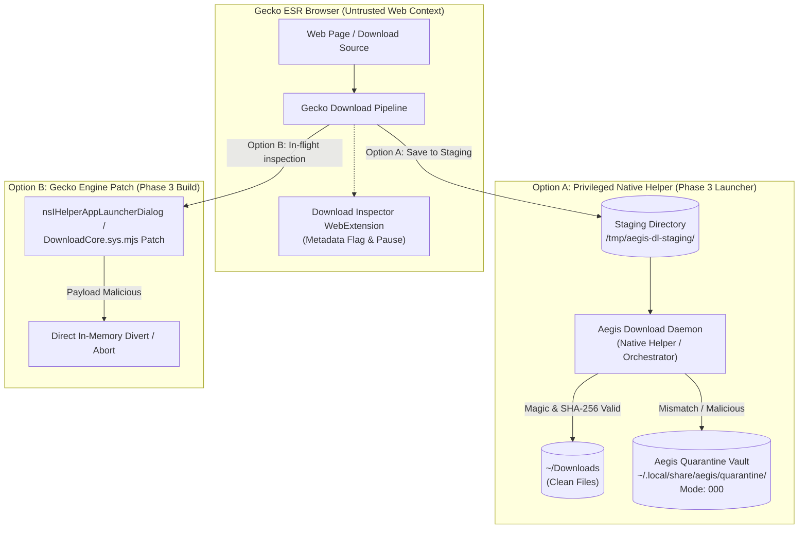

# SPIKE-007: Byte-Level Download Inspection and Quarantine Architecture

**Document Version:** 1.0.0  
**Date:** 2026-10-24  
**Status:** DESIGN ONLY (Exploratory spike; no implementation until approved)  
**Addresses:** Master Spec Part 5.8 (M8 Download Inspector), Part 5.2 row 8 (Quarantine integration)  
**Target Engine:** Mozilla Firefox ESR 153.5.1esr on Linux x86_64  

---

## 1. Problem Statement & WebExtension Sandbox Limits

In Phase 2d, the **Download Inspector** (`modules/download-inspector`) was implemented as a WebExtension operating under least privilege:
* **Permissions:** `downloads`, `storage` only.
* **Prohibited:** `<all_urls>` (host permission), `nativeMessaging`, `tabs`, filesystem access.

### 1.1 The WebExtension Limitation
Under Gecko's WebExtension architecture, `browser.downloads.onCreated` receives a `DownloadItem` object containing metadata only:
* `downloadItem.id`, `downloadItem.url`, `downloadItem.filename`, `downloadItem.mime`, `downloadItem.fileSize`.

The WebExtension runtime **cannot read raw file bytes** for the following reasons:
1. **No Filesystem Access:** WebExtensions execute in a restricted sandbox without POSIX file I/O capabilities. They cannot open the destination file path returned by Gecko.
2. **No Cross-Origin Re-fetch:** Without `<all_urls>`, background scripts cannot `fetch(downloadItem.url)`.
3. **Re-fetching is Unsound:** Even if `<all_urls>` were granted, re-fetching download URLs over HTTP/HTTPS is flawed:
   - Downloads often use single-use tokens, POST requests, or authenticated sessions that fail or mutate state on re-request.
   - Re-downloading wastes network bandwidth and does not guarantee that the re-fetched bytes match what Gecko wrote to disk.
4. **Mislabeling "Quarantine":** The WebExtension can only log/flag metadata and call `browser.downloads.pause(downloadItem.id)`. It cannot isolate the file in a secure filesystem vault. Calling this "quarantine" was inaccurate; it is an **audit log and download pause** mechanism.

### 1.2 Constraint
**Do NOT widen WebExtension permissions.** Adding `<all_urls>` or arbitrary native messaging to the extension manifest violates least-privilege principles and introduces a massive attack surface. Genuine byte-level inspection and file isolation must be handled outside the untrusted WebExtension sandbox.

---

## 2. Architectural Alternatives for Byte/Hash Inspection

---

## 3. Detailed Option Evaluation

### Option A: Privileged Native Helper Daemon
In Option A, the browser is configured via preferences (`browser.download.dir`, `browser.download.folderList: 2`) to write all incoming downloads into a private, monitored staging directory (e.g. `/run/user/<UID>/aegis/staging/` or `~/.local/share/aegis/staging/`).

1. **Flow:**
   - Gecko streams the download into the staging directory.
   - When download completes (`downloads.onChanged` [state: 'complete'] or inotify watch), the Aegis Native Helper (part of the Aegis Orchestrator, see [SPIKE-006](SPIKE-006-launcher-orchestrator.md)) reads the first 4KB of the file.
   - **Signature Verification:** Validates magic bytes (MZ, ELF, Mach-O, PDF, ZIP, PNG, etc.) against the claimed extension.
   - **Integrity Hash:** Calculates full file SHA-256 hash using native cryptographic libraries.
   - **Triage:**
     - **Clean:** Atomic `rename()` / `move` into `~/Downloads/`.
     - **Flagged / Malicious:** Atomic move into `~/.local/share/aegis/quarantine/`, permissions stripped (`chmod 0000`), logged to Flight Recorder.
2. **Security & Privilege Boundaries:**
   - WebExtension remains strictly least-privilege (no host permissions).
   - Helper runs in user space but operates out-of-process from the browser rendering engine.
   - File is unreadable by desktop applications while in staging and quarantine.
3. **Limitations:**
   - File bytes briefly reside on disk in staging before inspection.
   - Requires the launcher/orchestrator daemon to be running.

### Option B: Gecko Engine Patch in Download Pipeline
In Option B, inspection is embedded directly into Gecko's download pipeline source code (`toolkit/components/downloads/DownloadCore.sys.mjs` and `uriloader/exthandler/nsIHelperAppLauncherDialog.cpp`):

1. **Flow:**
   - Gecko's download channel streams bytes through an in-memory `nsIStreamListener` tee.
   - As the initial chunk arrives (first 4KB), Gecko checks the magic signature against the destination filename.
   - If a high-risk mismatch is detected (e.g. `.pdf` containing `MZ` binary header):
     - The channel is immediately canceled (`NS_BINDING_ABORTED`).
     - No file is created on the filesystem.
     - A native Gecko alert / security prompt is displayed to the user.
2. **Security & Privilege Boundaries:**
   - Strongest possible security guarantee: malicious payloads never touch disk storage.
   - Fully integrated into browser UI without external helper processes.
3. **Limitations:**
   - Requires maintainable C++/JS patches to upstream Mozilla source code ([BUILD.md](../../BUILD.md)).
   - Must be re-tested and re-based across ESR major versions.
   - Scheduled for Phase 3 (Source Engine Builds).

---

## 4. Comparison Matrix

| Evaluation Dimension | WebExtension (Current Live) | Option A: Native Helper | Option B: Engine Patch |
| :--- | :--- | :--- | :--- |
| **Inspection Scope** | Metadata only (name, claimed ext, size) | Byte magic (first 4KB) + SHA-256 | Stream magic + on-the-fly SHA-256 |
| **WebExtension Permissions** | Least privilege (`downloads`, `storage`) | Least privilege (no changes) | None required (engine native) |
| **Tamper Resistance** | Low (user can unpause or open file) | High (isolated staging directory) | Maximum (payload never touches disk) |
| **True Quarantine** | No (only pause / audit log) | Yes (isolated vault, chmod 000) | Yes (immediate cancel/divert) |
| **Implementation Complexity** | Zero (already built) | Moderate (Python/Rust IPC daemon) | High (Gecko C++ build pipeline) |
| **Phase Target** | **Phase 2d (active)** | **Phase 3 (Orchestrator)** | **Phase 3 (Engine Build)** |

---

## 5. Decision & Next Steps

1. **Terminology Clarification (Phase 2d):**
   - The current WebExtension module is documented accurately as **Download Inspector (Metadata Audit & Pause)**.
   - References to "quarantine" in the WebExtension are renamed to "flag log" / "audit log".
2. **Zero Permission Expansion:**
   - Under no circumstances will `<all_urls>` or `nativeMessaging` be added to `modules/download-inspector/manifest.json` in Phase 2d.
3. **Phase 3 Implementation Path:**
   - Implement **Option A** within the Aegis Orchestrator daemon ([SPIKE-006](SPIKE-006-launcher-orchestrator.md)) to provide filesystem-level quarantine staging without engine modifications.
   - Evaluate **Option B** as an upstream patch during custom Gecko engine compilation ([BUILD.md](../../BUILD.md)).
